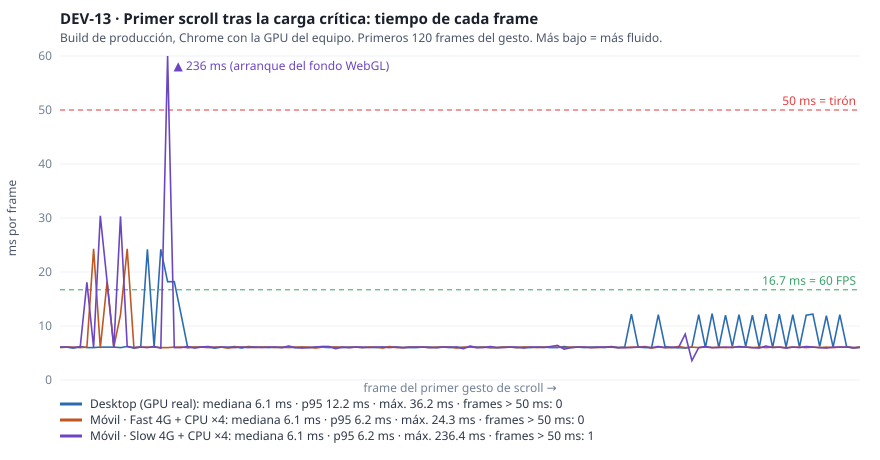

# DEV-13 · Preloader por prioridades

**Fecha:** 22-11-2026 · **Rama:** `feat/dev-13-preloader` (sobre `fix/bug-02-cls-titular`)
**Scripts:** `Manuales/qa/scripts/preloader.cjs` (tiempos, red, primer scroll) y `preloader-botones.cjs` (botones)

## Cómo funciona

El Manual (Paso 22) dice que el preloader «marca el tono, pero **no es una barrera**». Por eso no hay pantalla de
carga: el hero, el `<h1>` (en el HTML del servidor) y el CTA se usan desde el primer momento. El preloader solo
ordena qué se descarga primero y muestra un panel discreto abajo, que no tapa el titular.

1. **Carga crítica:**
   - Las fuentes.
   - Los **primeros 15 frames de la historia** en la variante del tier. Antes de pedir frames se espera a detect-gpu
     (máx. 1.5 s), también en la propia secuencia. Antes, la secuencia empezaba con la variante del tier por defecto
     (T2, frames *mobile*) y en desktop la cambiaba al resolver detect-gpu.
   - El **primer frame del shader** de fondo, que confirma que está compilado.
   - Al terminar se marca `kuvaros:critical-done` (Performance API).
   - Desde DEV-40 la historia es una sola secuencia (hamburguesa → bolsa). El arranque del segundo clip va primero en
     segundo plano.
2. **Red lenta** (el navegador informa 3G o menos, o < 2 Mbps): se reduce a 8 frames y no se espera al shader, que es
   decorativo.
3. **Resto en segundo plano:**
   - Arranca cuando el hilo principal está libre (`requestIdleCallback`), con prioridad baja y **2 descargas a la
     vez**. Con ≤ 2 en curso la red cuenta como «quieta» y el streaming no retrasa la interactividad.
   - Los frames van al caché HTTP sin decodificar, así que la memoria de GPU no cambia (DEV-26).
   - No corre con «ahorro de datos» ni en 2G.
4. **Sin descargas dobles:** el preloader y la ventana deslizante comparten la descarga en curso de cada frame
   (`lib/sequence/prefetch.ts`, con tests).
5. **Panel:**
   - Muestra progreso, «Saltar» y, si hay audio (DEV-16), «Entrar con sonido», que activa el sonido dentro del gesto.
   - Se va solo al terminar (sin audio), al desplazarse, con Escape o al pulsar un botón. El foco pasa al contenido.
   - Aparece cuando las fuentes ya están cargadas, con alto fijo: CLS 0.
6. **Peso:** el panel llega con `dynamic import` (`ssr: false`). JS inicial: 248.0 KB gzip, dentro del budget de DEV-01.

Archivos nuevos:
- `components/dom/Preloader.tsx` (+ `.css`)
- `config/preload.ts`
- `lib/preload/plan.ts`
- `lib/sequence/prefetch.ts`
- `store/waitFor.ts`

Cambios en archivos existentes:
- **Store:** `gpuReady` y `canvasReady`.
- **`ImageSequenceCanvas`:** espera el tier.
- **`FrameCache`:** descarga compartida.
- **`BackgroundShaderQuad`:** avisa su primer frame.
- **`layout.tsx`:** una línea para montar el preloader y `tabIndex={-1}` en `<main>`.

## Resultados

Build de producción y Chrome con la GPU real. Móvil: 412×823 con CPU ×4.

| Perfil | Carga crítica | Frames descargados | Descargas repetidas | Máx. de bitmaps vivos | Fin del streaming |
| :--- | :-: | :-: | :-: | :-: | :-: |
| Desktop (sin límite de red) | **0.51 s** ✅ | 211 (solo `desktop`) | 0 | 71 (2R+1, T3) | 0.9 s |
| Móvil · Fast 4G | **1.61 s** ✅ | 211 (solo `mobile`) | 0 | 17 | 11.4 s |
| Móvil · Slow 4G | **3.63 s** ⚠ | 211 (solo `mobile`) | 0 | 17 | 32.8 s |

**Slow 4G pasa de 2.5 s:** el HTML y el JS inicial de la página tardan unos 2 s antes de que el preloader pueda
empezar. El modo de red lenta bajó la carga crítica de 4.56 a 3.63 s. Aun así, la página no se bloquea: el titular es
el LCP (0.9 s en Lighthouse) y el CTA funciona desde el principio.

### Primer scroll (criterio 5)

| Perfil | Mediana | p95 | Máximo | Frames > 50 ms |
| :--- | :-: | :-: | :-: | :-: |
| Desktop | 6.1 ms | 12.2 ms | 36.2 ms | **0** |
| Móvil · Fast 4G | 6.1 ms | 6.2 ms | 24.3 ms | **0** |
| Móvil · Slow 4G | 6.1 ms | 6.2 ms | 236 ms | 1 |

En Slow 4G hay un frame de 236 ms. En red lenta la carga crítica no espera al fondo WebGL, así que three.js se
inicializa durante ese primer gesto. Es el precio de no frenar lo esencial por algo decorativo. El scroll se lee del
navegador mientras la descarga en segundo plano sigue en curso, así que esa descarga no lo bloquea.

### Botones (criterio 3)

Con un audio de prueba temporal (no subido) y sin audio:

| Acción | Resultado |
| :--- | :--- |
| Clic en «Entrar con sonido» | El panel se va, el sonido arranca (`AudioContext` en marcha, botón de la cabecera `aria-pressed=true`) y el foco pasa al contenido ✅ |
| Tab hasta «Entrar con sonido» + Espacio | Igual ✅ |
| Clic en «Saltar» | El panel se va sin sonido y el foco pasa al contenido ✅ |
| Tab hasta «Saltar» + Enter | Igual ✅ |
| Escape | El panel se va ✅ |
| Sin audio en `/public` | Solo aparece «Saltar», y el panel se va solo 0.9 s después de terminar ✅ |

El panel no tapa el `<h1>` en 1440 ni en 375 px. 0 errores en consola.

### `<h1>` y regresión (criterio 4)

- El `<h1>` está en el HTML que envía el servidor.
- El preloader no lo tapa ni lo retrasa: es un panel fijo abajo, llega después de hidratar y no está en el HTML.
- Sin JavaScript, el titular igual aparece: al instante con reduced motion, o a los 2.5 s por el *failsafe* de DEV-18.
  La espera es la de la animación de entrada, no la del preloader.

**Lighthouse móvil ×3** (equipo libre, `benchmarkIndex` 4373-4510):

| Medida | Resultado | Antes de DEV-13 |
| :--- | :-: | :-: |
| Rendimiento | 100 · 100 · 100 | — |
| LCP | 0.9 s | — |
| CLS | 0 | — |
| TBT | 80–90 ms | 70–90 ms |

Además:

- **Layout Shift:** 0 desplazamientos en 412, 375, 768 y 1440 px. Durante la prueba se corrigieron dos que causaba el
  propio panel: el texto de estado en dos líneas y el «100 %» partido.
- **CSP (DEV-34):** 0 violaciones, 0 errores, recorrido completo.
