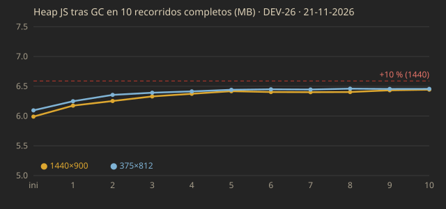

# DEV-26 · Informe de memoria (heap y GPU) y fugas

**Fecha:** 21-11-2026 · **Código:** `main` `2d442b7` + DEV-38/39/40/17/18/30/25/24/29 (rama `docs/dev-26-informe-memoria`)
**Build:** producción local (`next build` + `next start`, puerto 3102) · **Navegador:** Chrome 157 headless (puppeteer-core),
movimiento completo (Lenis activo) y rueda real del ratón · **Script:** `Manuales/qa/scripts/memoria.cjs`

## Método

1. Se carga la página y, antes de que corra el código del sitio, se instrumenta `createImageBitmap` e `ImageBitmap.close()`. Así se cuentan los frames decodificados vivos y sus bytes (ancho × alto × 4): es la memoria de texturas de las secuencias, la que se sube a la GPU.
2. Se hace un **recorrido completo** con la rueda: de arriba hasta el final y de vuelta arriba (11-12 s en desktop, 7-8 s en móvil). Se repite **10 veces**.
3. Tras cada recorrido se fuerza el recolector de basura (`HeapProfiler.collectGarbage`) y se lee el heap JS (`Performance.getMetrics` → `JSHeapUsedSize`), los bitmaps vivos y el búfer de dibujo de los canvas (ancho × alto × 4 de cada uno).

## Resultados

### Heap JS (MB, tras GC)

| Viewport | Inicial | 1 | 2 | 3 | 4 | 5 | 6 | 7 | 8 | 9 | 10 | Variación |
| :--- | :-: | :-: | :-: | :-: | :-: | :-: | :-: | :-: | :-: | :-: | :-: | :-: |
| 1440×900 | 5.99 | 6.18 | 6.25 | 6.33 | 6.37 | 6.42 | 6.40 | 6.40 | 6.40 | 6.43 | 6.44 | **+7.6 %** |
| 375×812 | 6.10 | 6.25 | 6.36 | 6.39 | 6.41 | 6.44 | 6.45 | 6.45 | 6.46 | 6.46 | 6.46 | **+5.9 %** |

El heap crece en los primeros recorridos (cachés de módulos, JIT, `ScrollTrigger` con sus medidas) y se **estabiliza**
desde el recorrido 5-6, con menos de 0.05 MB de diferencia entre los últimos cinco. Queda dentro del ±10 % del criterio y
no aumenta con cada recorrido, así que no hay fuga. La verificación del 21-11 en el navegador integrado dio lo mismo:
8.2 → 8.6 MB (+4.9 %).

### Memoria de texturas de las secuencias (GPU)

| Viewport | Bitmaps vivos en reposo | Máximo en todo el recorrido | MB en reposo | MB máximo | Creados / cerrados en 10 recorridos |
| :--- | :-: | :-: | :-: | :-: | :-: |
| 1440×900 | 9 | **17** | 12.4 | 23.4 | 3605 / 3596 |
| 375×812 | 9 | **17** | 12.4 | 23.4 | 4016 / 4007 |

- El headless usa SwiftShader, así que `detect-gpu` lo clasifica como **Tier 1** (radio R = 8, variante `mobile`). El máximo de bitmaps vivos fue **17 = 2R + 1** en los dos viewports: la ventana deslizante nunca se pasa de su radio.
- **Creados − cerrados = vivos** en todo momento (9 al final, la ventana actual): cada frame que sale de la ventana se libera con `close()`.
- El máximo (23.4 MB) queda dentro de `maxSequenceVRAM_MB` de T1 (32 MB).
- En un desktop real (Tier 2-3, radio mayor) rige la misma regla: la verificación del 21-11 en el navegador integrado ya había medido como máximo 2R+1 frames con el tier que asignó `detect-gpu`.

### Búfer de los canvas (GPU)

| Viewport | Canvas | Bytes de dibujo | Al terminar |
| :--- | :-: | :-: | :-: |
| 1440×900 | 2 (WebGL de fondo + secuencia 2D) | 10.4 MB | 10.4 MB (sin cambio) |
| 375×812 | 2 | 2.4 MB | 2.4 MB (sin cambio) |

Hay un solo Canvas WebGL (Single-Canvas). Ningún canvas se crea ni se agranda durante el recorrido.

## Limpieza al desmontar (criterio 4, verificado el 21-11)

- `ImageSequenceCanvas` mata su timeline y su `ScrollTrigger` y cierra todos los bitmaps; `SmoothScrollProvider` destruye Lenis y quita sus listeners del ticker y de la ventana. Con StrictMode (que monta, desmonta y vuelve a montar) queda **1** pin-spacer, no 2.
- Los componentes nuevos de esta tanda también se limpian: `StickyHeader` (listener de scroll), `HeroTitle` (`revert()` + `kill()` de SplitText), `CustomCursor` (ticker, 5 listeners y el atributo de `<html>`) y `ContactForm` (no tiene listeners globales).

## Conclusión

Los cinco criterios de DEV-26 se cumplen:
- `useState` revisado.
- Heap estable dentro del ±10 %.
- Ventana de bitmaps ≤ 2R+1.
- Limpieza al desmontar.
- Este informe, con las mediciones de heap y GPU.

Para repetirlo con otro build o en otra máquina: `Manuales/qa/scripts/memoria.cjs`.
