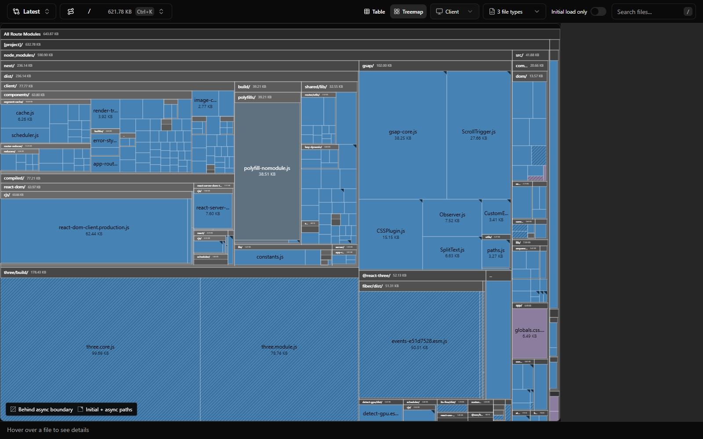

# DEV-28 · Core Web Vitals y bundle

**Fecha:** 22-11-2026 · **Rama:** `feat/dev-28-cwv-bundle` (sobre `feat/dev-15-postprocesado`)
**Build:** producción local (`next build` + `next start`) · **Navegador:** Chrome 157
**Equipo:** sin carga; `benchmarkIndex` de Lighthouse entre 4264 y 4535. Con el equipo ocupado este índice baja a ~1580 y los tiempos se triplican: ver DEV-29.

## 1. Core Web Vitals (móvil)

### Lighthouse móvil

Perfil por defecto: Moto G Power emulado, red 4G lenta y CPU ×4. Informe completo de la corrida 1 en
[`DEV-28/lighthouse-movil.html`](./DEV-28/lighthouse-movil.html).

| Corrida | Rendimiento | LCP | CLS | TBT | Accesibilidad · Buenas prácticas · SEO |
| :-: | :-: | :-: | :-: | :-: | :-: |
| 1 | 100 | 0.9 s | 0 | 80 ms | 100 · 100 · 100 |
| 2 | 100 | 0.9 s | 0 | 90 ms | 100 · 100 · 100 |
| 3 | 99 | 0.9 s | 0 | 90 ms | 100 · 100 · 100 |

El elemento LCP es el `<h1>` del hero (`data-hero-title`), que llega en el HTML del servidor.

### INP (laboratorio)

Lighthouse en modo navegación no mide INP, así que se mide con `Manuales/qa/scripts/inp.cjs`. El script emula un móvil
de 412×823 con CPU ×4, hace interacciones reales y registra las entradas `event` del navegador. Interacciones:

- toque en el CTA de la cabecera;
- toque en el logo;
- Tab + Enter en «Saltar al contenido»;
- con el formulario activo: enviarlo vacío (aparecen los errores) y escribir en sus 4 campos.

| Build | Interacciones medidas | INP (peor interacción) | La más lenta |
| :--- | :-: | :-: | :--- |
| Producción tal cual (sin formulario: no hay servicio de envío) | 4 | **80–88 ms** | toque en el CTA de la cabecera |
| Con `CONTACTO_ENVIO=simulado` (formulario visible) | 72–73 | **104–120 ms** | toque en el CTA de la cabecera |

Todos los valores quedan bajo los umbrales de FLUJO §3.7: LCP < 2.5 s, CLS < 0.1, INP < 200 ms.

## 2. Bundle

Analizador integrado de Next 16 (Turbopack), sin dependencias nuevas:

```bash
npm run analyze -- --output --snapshot <nombre>
npx next analyze export --snapshot <nombre> --route / > grafo.jsonl   # en Git Bash: MSYS_NO_PATHCONV=1 delante
python Manuales/qa/scripts/bundle-inicial.py grafo.jsonl
```



### JS de la ruta `/`

**Medido sobre lo que viaja** (`npm run budget`, DEV-01: gzip nivel 6 de los scripts que pide el HTML):
**246.4 KB gzip · 214.8 KB brotli** (Vercel sirve brotli). El budget de DEV-01 es ≤ 250 KB gzip en móvil y ≤ 350 KB
en desktop: ✅ dentro, con un margen de 3.6 KB en móvil. Todo lo nuevo que pese tiene que ir con `dynamic import`.

El analizador da otra cifra, que es su propia estimación de compresión y queda por encima de la real. Sirve para
comparar módulos entre sí, no para controlar el budget:

| Estimación del analizador | Antes | Ahora |
| :--- | :-: | :-: |
| JS inicial | 292.7 KB | 292.0 KB |
| JS diferido con `dynamic import` | 238.5 KB (Canvas WebGL) | 239.7 KB (Canvas WebGL + cursor) |

`polyfill-nomodule.js` (38 KB) aparece en el treemap, pero solo lo descargan navegadores sin módulos ES; los actuales no lo piden.

### Qué hay en el JS inicial (estimación del analizador, KB)

| Paquete | KB | Comentario |
| :--- | :-: | :--- |
| `next` (incluye React y React DOM) | 212.3 | Framework: no se puede reducir desde la app |
| `gsap` (core 19.2 · ScrollTrigger 13.8 · CSSPlugin 7.6 · Observer 3.8 · SplitText 3.3 · CustomEase 1.7) | 51.1 | Lo usan el titular (SSR, LCP) y la historia fijada |
| Código del sitio (`src/`) | 15.8 | Ningún componente pasa de 1.5 KB |
| `lenis`, `detect-gpu`, `zustand` y runtime de Turbopack | ~13 | — |

### Dynamic import

- **Canvas WebGL** (three.js, R3F y drei: 238 KB comprimidos, el 45 % de todo el JS): diferido desde DEV-07.
- **Cursor personalizado** (nuevo en esta tarjeta, `CustomCursorLoader`): solo se descarga con ratón y sin reduced motion.
  Comprobado en producción:

  | Caso | Se descarga el chunk del cursor | Cursor activo |
  | :--- | :-: | :-: |
  | Escritorio con ratón | sí | sí |
  | Escritorio con reduced motion | no | no |
  | Móvil táctil | no | no |

- **Las secciones (historia en video, contacto) no se dividen.** Cada una pesa 1-1.5 KB comprimidos. Además, la historia
  tiene que estar en el HTML del servidor para que ScrollTrigger mida el pin y para el SEO. Dividirlas sumaría
  peticiones sin bajar el peso. Lo pesado de la historia son los frames, que ya se cargan por ventana deslizante (DEV-09).

## Pendiente

- El budget de DEV-01 sigue los valores del Manual porque no hay analítica del cliente. Si DIR lo cambia, se vuelve a
  comprobar con `npm run budget`.
- Repetir Lighthouse e INP en la Preview URL de Vercel y en un Android real, cuando estén disponibles.
